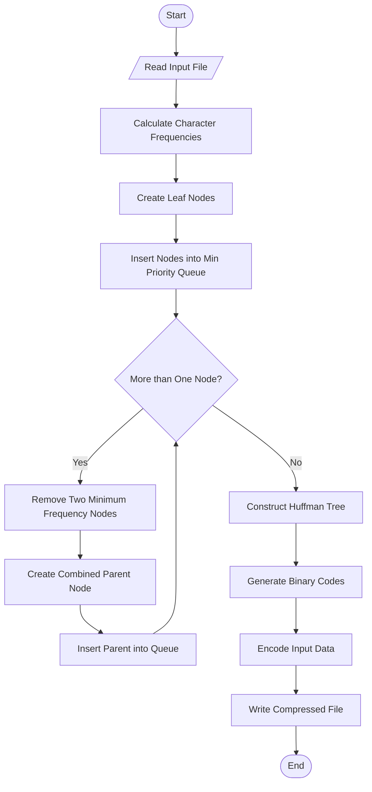
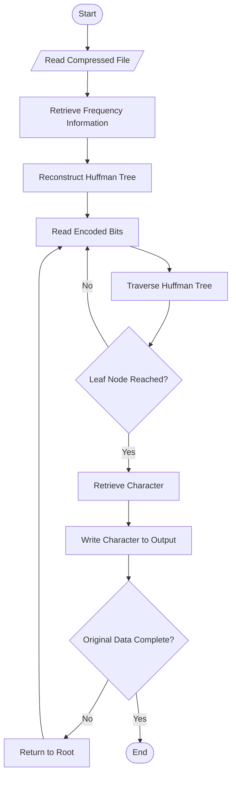
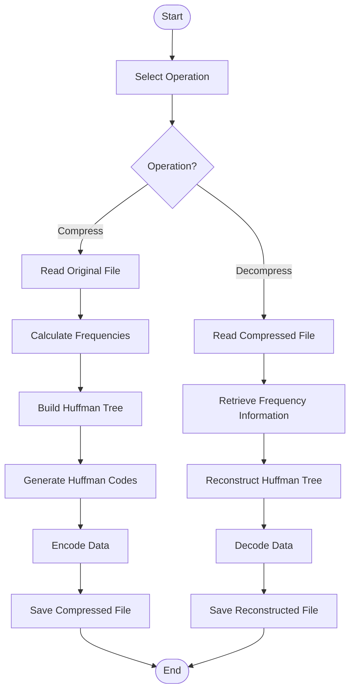

# Huffman File Compression Using C++

**Academic Project | Data Structures and Algorithms**

## 1. Project Overview

Huffman File Compression is a C++ project that implements the Huffman Coding algorithm for lossless data compression.

It reduces the size of data by assigning variable-length binary codes to characters based on their frequency of occurrence. The original data can be reconstructed through decompression without losing information.

The project contains two implementations:

- **Modular Implementation:** Organized using separate header and source files.
- **Single-File Implementation:** Complete implementation in one C++ source file.

## 2. Problem Statement

Storing and transferring files efficiently is an important requirement in computing. Fixed-length encoding can use unnecessary bits when representing characters with different frequencies.

This project implements Huffman Coding to provide an efficient variable-length encoding technique that reduces data size while maintaining the original information.

## 3. Objectives

- Implement the Huffman Coding algorithm using C++.
- Understand greedy algorithm techniques.
- Apply binary trees and priority queues.
- Perform lossless file compression and decompression.
- Understand binary file handling and bit manipulation.
- Develop modular and single-file implementations.

## 4. Technologies Used

| Component | Technology |
|---|---|
| Programming Language | C++ |
| Standard | C++17 |
| Algorithm | Huffman Coding |
| Data Structures | Binary Tree, Priority Queue |
| Concepts | Greedy Algorithm, File Handling, Bit Manipulation |

## 5. Project Structure

```text
File-compression-/
│
├── docs/
│   └── CODE_WALKTHROUGH.md
│
├── examples/
│
├── include/
│
├── output/
│
├── single-file/
│   ├── huffman.cpp
│   └── README.md
│
├── src/
│
├── tests/
│
└── README.md
```

## 6. Algorithm

### 6.1 Compression Algorithm

**Input:** Original input file.

**Output:** Compressed file.

1. Start.
2. Read the input file.
3. Calculate the frequency of each character.
4. Create a leaf node for each character.
5. Insert all leaf nodes into a min-priority queue.
6. Remove the two nodes with the lowest frequencies.
7. Create a new internal node with the combined frequency of the two nodes.
8. Assign the removed nodes as its left and right children.
9. Insert the new node into the priority queue.
10. Repeat steps 6–9 until only one node remains.
11. Treat the remaining node as the root of the Huffman tree.
12. Generate binary codes by traversing the tree:
    - Left edge represents `0`.
    - Right edge represents `1`.
13. Encode the input data using the generated codes.
14. Store the required frequency information and encoded data in the compressed file.
15. Stop.

### 6.2 Decompression Algorithm

**Input:** Compressed file.

**Output:** Reconstructed original file.

1. Start.
2. Read the compressed file.
3. Retrieve the stored frequency information.
4. Reconstruct the Huffman tree.
5. Read the encoded binary data.
6. Traverse the Huffman tree according to each bit:
   - `0`: Move to the left child.
   - `1`: Move to the right child.
7. When a leaf node is reached, retrieve the corresponding character.
8. Write the decoded character to the output file.
9. Return to the root of the tree.
10. Repeat until the original data has been reconstructed.
11. Stop.

## 7. Flowcharts

### 7.1 Compression Flowchart



### 7.2 Decompression Flowchart



### 7.3 Overall System Flowchart



## 8. How to Compile and Run

### Requirements

- C++17-compatible compiler
- GCC or Clang
- Terminal or command prompt

### Single-File Implementation

Source file:

```text
single-file/huffman.cpp
```

Compile:

```bash
g++ -std=c++17 -O2 single-file/huffman.cpp -o huffman
```

Compress:

```bash
./huffman compress input.txt output.huff
```

Decompress:

```bash
./huffman decompress output.huff restored.txt
```

On Windows, execute `huffman.exe` instead of `./huffman`.

### Modular Implementation

The modular implementation is organized into separate header files and source files.

Refer to the project source files and their entry point for the appropriate compilation and execution instructions.

## 9. Expected Results

The project is expected to:

- Read the original input file.
- Generate a compressed output file.
- Decode the compressed file.
- Reconstruct the original data.
- Preserve the original content without data loss.

The original and reconstructed files can be compared to verify the correctness of decompression.

## 10. Applications

- Data storage optimization
- Lossless data compression
- Efficient data representation
- File compression systems
- Fundamentals of encoding and decoding

## 11. Conclusion

This project demonstrates the practical implementation of the Huffman Coding algorithm using C++.

It provides an understanding of greedy algorithms, binary trees, priority queues, file handling, and bit manipulation through a practical compression and decompression application.

## 12. Author

**GitHub:** [25A31A05GB](https://github.com/25A31A05GB)

**Project Repository:** [Huffman File Compression](https://github.com/25A31A05GB/File-compression-)
